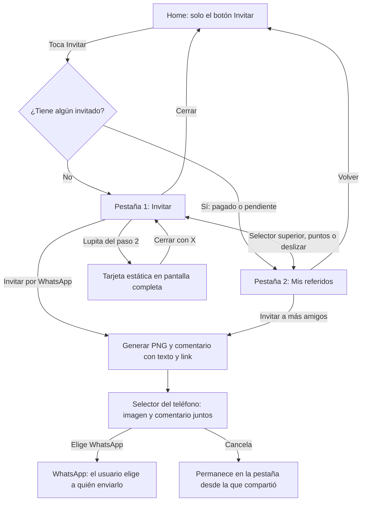
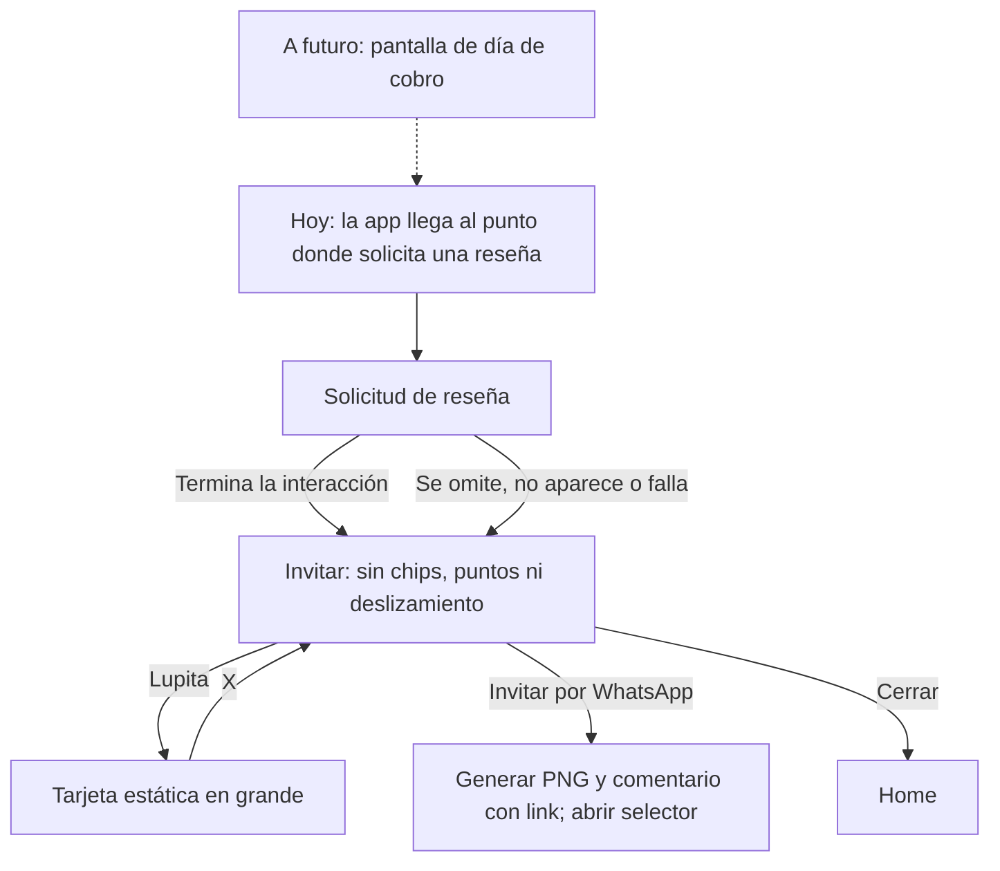

# Tu Turno · Referidos para integrar paso a paso

Este repositorio es una muestra pequeña que puedes abrir, probar y usar como
referencia para agregar el flujo de referidos a Tu Turno. Incluye las pantallas,
los textos, las animaciones, Tutu y las medallas oficiales.

**Tu tarea es llevar este flujo a la app actual, conservando su diseño y conectando
los datos reales del usuario.** Puedes apoyarte en Claude o Codex: más abajo tienes
un texto listo para copiar y pegar.

## Primero: entiende qué debe pasar

Hay **dos entradas al mismo contenido, con navegación diferente**:

1. La persona toca **Invitar** desde Home: si ya tiene algún invitado, abre
   **Mis referidos**; si no tiene ninguno, abre **Invitar**.
2. La app solicita una **reseña** y después abre **Invitar sin pestañas**.

| Desde dónde entras | Qué aparece | Cómo navegas |
| --- | --- | --- |
| Home, sin invitados | **Invitar** | Chips superiores, puntos y deslizamiento |
| Home, con al menos un invitado pagado o pendiente | **Mis referidos** | Las mismas dos pestañas y controles |
| Después de la reseña | Solo **Invitar** | Sin chips, sin puntos y sin deslizamiento entre páginas |

Se reutilizan el mismo contenido y la misma lógica de compartir en ambos modos.
La imagen **«Mira cómo voy» se genera para compartir por WhatsApp**. No es otra
pantalla por la que el usuario deba pasar. La lupita del paso 2 permite verla
en grande, de forma opcional, y cerrarla con la X para volver a Invitar.

**Imagen + comentario con texto y enlace es un requisito en Android y iPhone.**
No se debe pedir al usuario que pegue el enlace a mano. Los links, los invitados
pendientes y los premios **no vencen**. «Por tiempo limitado» se refiere al
programa, no a una cuenta regresiva individual.

## Mapita 1: entrada desde Home



El recorrido de Home conserva las dos pestañas. La página que se abre depende
de si ya hay invitados; la muestra de Pedro tiene siete, por eso empieza en
**Mis referidos**. La vista ampliada se abre desde la lupita de **Invitar**.


[Ver o descargar el video de Home en MP4](docs/media/flujo-home.mp4).

**Qué debes observar al probarlo:**

- Desde Home no se pide una reseña.
- Sin invitados se abre **Invitar**; con uno o más, pagados o pendientes, **Mis referidos**.
- El orden del selector no cambia: Invitar a la izquierda, Mis referidos a la derecha.
- Puedes cambiar de pestaña tocando los chips, los puntos o deslizando.
- **Mis referidos** muestra quién pagó, quién está **Pendiente** y el total ganado.
- Los botones verdes de ambas pestañas comparten la misma tarjeta y el enlace.
- **Copiar link** solo copia el enlace; no abre WhatsApp ni genera la imagen.
- La lupita abre la tarjeta estática en pantalla completa; la X vuelve a Invitar.
- Compartir no exige abrir esa vista previa y envía PNG, comentario y enlace juntos.

## Mapita 2: entrada desde la reseña



Grabación de este recorrido en Android: después de la **simulación de reseña**
se abre la invitación sola, sin chips, sin puntos y sin cambio de página al
deslizar. También se muestra la generación de la imagen para compartir.


[Ver o descargar el video de la reseña en MP4](docs/media/flujo-resena.mp4).

**La app actual no tiene pantalla de día de cobro.** Por ahora conecta este flujo
desde donde se pide la reseña. El cuadro punteado del mapa es una conexión futura,
no una pantalla que debas crear en esta entrega.

Después de la reseña solo se muestra la invitación. Para consultar referidos,
cierra esta pantalla, toca **Invitar** desde Home y abre **Mis referidos**.

La reseña nunca debe ser un requisito para acceder a la invitación. No importa
cuántas estrellas elija la persona ni si la tienda decide no mostrar el diálogo.

En este mini repo, **Simulación de reseña** sirve para probar el recorrido sin
publicar una calificación. En la app real se usa la solicitud nativa de la tienda.
En iOS, la tienda no informa cuándo se cerró el diálogo ni si se publicó una
reseña; no se debe inventar esa confirmación. Los detalles están al final.

## Cómo abrir la muestra en tu computadora

Necesitas **Git**, **Node.js 22.13 o posterior** y las herramientas de Android o
Xcode para iOS. En Android usa **JDK 17** para Gradle; el JDK 25 incluido en
algunas versiones de Android Studio puede fallar al configurar CMake. Pide ayuda
para instalar las herramientas si es tu primera compilación.

1. Descarga el proyecto:

   ```sh
   git clone https://github.com/oscarmiranda90/tuturno-referidos-mini.git
   cd tuturno-referidos-mini
   npm ci
   npm run check
   ```

2. Crea e instala la **compilación de desarrollo** en tu dispositivo o simulador:

   ```sh
   npm run android
   ```

   En una Mac con Xcode, para iOS:

   ```sh
   npm run ios -- --device
   ```

   Es una app de prueba propia: incluye `react-native-share`, la pieza nativa que
   entrega imagen y comentario juntos. La primera compilación tarda más porque
   descarga y compila dependencias. No necesitas publicar en las tiendas.
   Un iPhone físico necesita la firma de desarrollo de tu equipo.

3. En los siguientes arranques, abre esa app de desarrollo y ejecuta:

   ```sh
   npm start
   ```

   Si el comando del paso 2 ya dejó Metro abierto, usa esa terminal.

4. Para comenzar por la reseña simulada, detén Metro y ejecuta:

   ```sh
   npm run start:review
   ```

   Prueba **Omitir reseña** y **Simular envío de reseña**: ambas opciones llevan a
   **Invitar sin chips, puntos ni deslizamiento**. Al cerrar y entrar desde Home,
   vuelven las dos pestañas y se elige la inicial según los invitados.

**Expo Go solo sirve para revisar la interfaz**, con `npm run start:go` y un
cliente compatible con SDK 57. No incluye `react-native-share`: allí el botón no
comparte la tarjeta. No hay sustitución por una imagen sin comentario ni por texto
copiado al portapapeles. Para aceptar el envío por WhatsApp usa la compilación de
desarrollo en Android e iPhone, con WhatsApp instalado.

## Básicamente: pégame en tu agente, Claude o Codex, y pídele esto

Abre **el proyecto de la app actual de Tu Turno** en tu editor y usa su agente.
Copia el bloque completo de abajo. El agente debe tener acceso tanto a la app
actual como a este repositorio de referencia. Si no lo tiene, comparte la carpeta
o el enlace; no necesita contraseñas ni datos de usuarios para estudiar la muestra.

```text
Necesito integrar el flujo de referidos en la app actual de Tu Turno.

Referencia pública:
https://github.com/oscarmiranda90/tuturno-referidos-mini

Primero lee su README y revisa su código. Revisa también la estructura y las
instrucciones del proyecto actual. Si no tienes acceso a alguno de los dos
proyectos, indícame exactamente qué carpeta necesitas.

Usa la muestra como referencia de pantallas, textos, márgenes, animaciones,
Tutu y medallas. Integra el flujo dentro de la app existente, respetando sus
herramientas y navegación. No reemplaces la app completa por la muestra ni
actualices su framework solo porque la muestra usa Expo SDK 57.

Implementa estas dos entradas:
1. Desde el botón Invitar del Home real: conservar Invitar como primera pestaña
   y Mis referidos como segunda, con chips, puntos y deslizamiento. Si existe
   al menos un invitado (pagado o pendiente), abrir Mis referidos; si no hay
   ninguno, abrir Invitar.
   No pedir una reseña en esta entrada. El Home vacío del mini repo solo sirve
   para demostrar el botón; conserva el Home de la app real.
2. Desde donde la app pide una reseña: usar la solicitud nativa existente y
   después mostrar SOLO Invitar, sin chips, sin puntos y sin deslizamiento.
   Mis referidos no debe quedar accesible con un gesto ni montado como página
   oculta en este modo. Si la reseña no aparece, se omite o falla, continuar
   igualmente a esta invitación sola. No exigir estrellas positivas ni afirmar
   que se publicó una reseña.

La app actual NO tiene pantalla de día de cobro. No la crees ni la uses como
requisito. A futuro esa pantalla podrá activar la misma secuencia de reseña.
La pantalla Simulación de reseña es solo para pruebas: no la uses como reseña
real en producción. Conserva los límites de frecuencia de la app actual.

Reutiliza el mismo componente de invitación, textos, recursos y lógica para
compartir. Usa dos modos explícitos según la entrada; no dupliques el contenido.
La muestra los llama mode="home" y mode="post-review".
- En Home: mantén sincronizados selector doble, puntos y deslizamiento.
- Después de la reseña: elimina esa navegación y conserva el botón de cerrar.
- Cerrar regresa a Home. Una nueva entrada desde Home recupera las dos pestañas.
- Conserva el confeti animado, Tutu y las medallas oficiales.
- Mantén los textos aprobados y el estado Pendiente del listado.

Mira cómo voy es una imagen estática para compartir. La miniatura y lupita del
paso 2 abren una vista previa a pantalla completa con una X para volver a Invitar.
No se anima, no abre WhatsApp y no es un paso obligatorio al compartir.
Al compartir, genera una imagen estática
1080x1920 con el nombre completo, los SAN cobrados confirmados y el nivel real
del usuario, junto con su enlace de referido. El contador no es la cantidad
de amigos ni de cuotas pagadas. No dejes el nombre Pedro ni la medalla Diamante
fijos: son datos de ejemplo. El usuario elige WhatsApp y los destinatarios.
En Android y iOS usa react-native-share para entregar PNG y comentario con el
texto aprobado y el enlace en la MISMA operación. No uses el portapapeles como
sustituto ni una entrega de imagen sola. Esto requiere una compilación de
desarrollo; Expo Go solo permite ver la interfaz. Comprueba en WhatsApp que
el destinatario recibe la imagen con el comentario y el link que puede tocar.

Conserva claro y oscuro en las tres piezas. En la tarjeta oscura: fondo azul,
logo blanco, globo de Tutu y panel inferior blancos, con texto legible.
En Colombia usa cadena con 1 y cadenas desde 2. Los links, los pendientes y
los premios no vencen: no agregues plazos, contadores ni estados de vencimiento.
Usa el mensaje exacto por país de la sección Mensaje de WhatsApp, con montos
obtenidos de la configuración.

Conecta la sesión y los servicios que ya existen. No inventes endpoints ni
confirmaciones de pagos. Si falta un dato o un servicio, separa claramente
la integración pendiente y explícame qué debe entregar el backend.

Prueba ambos modos: las dos pestañas desde Home y la invitación sin navegación
después de la reseña. Prueba la imagen personalizada en ambos. Ejecuta
los chequeos del proyecto. Al terminar, explícame en español:
- Qué archivos cambiaste y para qué.
- Cómo probar cada entrada paso a paso.
- Qué funciona y qué sigue pendiente de datos o pruebas en un teléfono real.
```

**Revisa el resultado con el agente.** Si dice que terminó, pídele que te muestre
ambos recorridos y la imagen generada con un perfil distinto al de la muestra.

## Cómo saber si la tarea está lista

- [ ] Desde Home, sin invitados abre **Invitar**, sin pedir reseña.
- [ ] Desde Home, con al menos un invitado pagado o pendiente abre **Mis referidos**.
- [ ] Desde la reseña se abre solo **Invitar**, incluso si no se califica.
- [ ] Después de la reseña no hay chips, puntos ni deslizamiento hacia referidos.
- [ ] El orden Invitar / Mis referidos y las tres formas de cambiar funcionan.
- [ ] Al cerrar la invitación sola y volver a entrar desde Home reaparecen las pestañas.
- [ ] Tutu, las medallas, los textos y el estado **Pendiente** se conservan.
- [ ] La imagen usa los datos reales del usuario y no es un paso obligatorio.
- [ ] La lupita abre la tarjeta estática con X; cerrar vuelve a Invitar.
- [ ] Las tres piezas funcionan en claro y oscuro; Colombia usa los plurales correctos.
- [ ] No hay vencimientos en datos, tipos, lógica ni estados visibles.
- [ ] Android e iPhone: el destinatario recibe tarjeta + comentario + enlace juntos.
- [ ] Hay un video de esa prueba por plataforma y capturas de las tres piezas en ambos modos.
- [ ] Copiar link sigue copiando solo el enlace.
- [ ] Los chequeos pasan y queda escrito qué datos o servicios faltan conectar.

## Evidencias y criterio de cierre

**Implementar el envío no demuestra que WhatsApp lo recibió correctamente.**
Los GIF de los mapitas explican la navegación; no sustituyen los videos de
aceptación con un destinatario de prueba.

Para cerrar la integración, adjunta:

- Un video en **Android físico**, desde Invitar hasta la recepción en WhatsApp de
  la imagen con su comentario y el link que se puede tocar.
- La misma prueba en **iPhone físico**. Comprueba el comentario, no solo la imagen.
- Capturas de **Invitar, tarjeta y Mis referidos**, en **claro y oscuro**, para
  Venezuela y Colombia. Revisa también los cuatro niveles y el caso de cero SAN.
- Prueba de la lupita y la X, Home con cero invitados y Home con al menos un
  pendiente; después de la reseña debe seguir apareciendo solo Invitar.

### Verificado en esta muestra

- `npm run check`: tipos, estructura, formato, español y pruebas de regresión.
- Compilaciones nativas y apertura de la app en Android e iOS.
- PNG exportado: **1080 × 1920** comprobado en los archivos de ambos sistemas.
- [Selector nativo Android con imagen, texto aprobado y link](docs/screenshots/android-compartir.png).
- [Selector nativo iOS con el PNG](docs/screenshots/ios-compartir.png). El código
  entrega el mismo comentario junto con la imagen; la conservación del comentario
  al recibir en WhatsApp se comprueba en la prueba física pendiente.

### Capturas actuales

Capturas de la compilación de desarrollo en Android; la tarjeta corresponde a
la vista estática ampliada. Cada enlace abre la imagen completa:

| País y apariencia | Invitar | Tarjeta | Mis referidos |
| --- | --- | --- | --- |
| Venezuela · claro | [Ver](docs/screenshots/ve-light-invitar.png) | [Ver](docs/screenshots/ve-light-tarjeta.png) | [Ver](docs/screenshots/ve-light-referidos.png) |
| Venezuela · oscuro | [Ver](docs/screenshots/ve-dark-invitar.png) | [Ver](docs/screenshots/ve-dark-tarjeta.png) | [Ver](docs/screenshots/ve-dark-referidos.png) |
| Colombia · claro | [Ver](docs/screenshots/co-light-invitar.png) | [Ver](docs/screenshots/co-light-tarjeta.png) | [Ver](docs/screenshots/co-light-referidos.png) |
| Colombia · oscuro | [Ver](docs/screenshots/co-dark-invitar.png) | [Ver](docs/screenshots/co-dark-tarjeta.png) | [Ver](docs/screenshots/co-dark-referidos.png) |

**Pendiente de aceptación:** los videos de entrega real por WhatsApp en ambos
sistemas. No se marcan como aprobados con pruebas unitarias, Expo Go ni solo
abriendo el selector del teléfono.

## Palabras que encontrarás

| Palabra | Qué significa aquí |
| --- | --- |
| Repositorio o repo | La carpeta de código con su historial de cambios. |
| Terminal | La ventana donde escribes comandos como `npm start`. |
| Dependencias | Las librerías que el proyecto necesita; se instalan con `npm ci`. |
| Metro | El servidor local que inicia Expo para cargar la app mientras desarrollas. |
| Backend | El servidor que entrega los datos y confirma las operaciones reales. |
| Datos de muestra | Información ficticia para ver las pantallas; no son datos de producción. |
| Reseña nativa | El diálogo de calificación que controla Android o iOS. |
| PNG | El archivo de imagen que se genera al compartir. |

## Referencia técnica para integrar

Puedes empezar con los pasos y mapas de arriba. Abre esta sección cuando necesites
los comandos adicionales, las limitaciones por plataforma o los archivos concretos.

<details>
<summary>Ver detalles técnicos, datos de ejemplo y organización del código</summary>

## Instalación y ejecución

Los pasos básicos están arriba. `npm run android` y `npm run ios` generan los
proyectos nativos e instalan la compilación de desarrollo. La configuración ya
activa el soporte oficial de escenas de Expo SDK 57 para compilar con Xcode 27
y abrir en iOS 27; conserva el plugin `expo-build-properties` y el parche de Expo
del lockfile. `npm start` sirve el
JavaScript a esa app. Después de cambiar módulos nativos o plugins, vuelve a
compilar. Los proyectos generados `android/` e `ios/` no se publican en este repo.

Para trabajar junto a la app completa usando otro puerto:

```sh
npm start -- --port 8083
```

Incluye Outfit, Tutu animado y estático, medallas oficiales y marca. Las tres
piezas admiten claro y oscuro. El proveedor de tema conserva la preferencia;
la app real debe conectar `useAppearance().setAppearance` con su configuración
existente. El Home de esta muestra mantiene solo el botón Invitar.

La web y Expo Go permiten revisar la interfaz. No sirven para aceptar el envío
combinado: no se ofrece una alternativa incompleta de compartir solo texto o imagen.

## Las dos maneras de entrar al flujo

| Entrada | Recorrido actual | Regreso |
| --- | --- | --- |
| Desde Home | Home vacío → botón **Invitar** → **Invitar** / **Mis referidos** | Cerrar o volver regresa a Home |
| Desde una solicitud de reseña de la app | Interacción de reseña → solo **Invitar**, sin navegación entre páginas | Cerrar regresa a Home |

**Desde Home**, Invitar es la primera pestaña y Mis referidos es la segunda.
El selector doble superior, los puntos y el deslizamiento controlan esas páginas.
**Después de la reseña**, se muestra únicamente Invitar: no hay selector, puntos
ni página de referidos accesible mediante deslizamiento.

La entrada desde Home no pide reseña: abre **Mis referidos** si existe cualquier
invitado, pagado o pendiente, y **Invitar** si no hay ninguno. La elección no usa
solo el total ganado ni solo los que pagaron. Después de la reseña siempre abre
Invitar, aunque ya tenga invitados.

### 1. Entrada desde Home

Al iniciar normalmente aparece un Home vacío con un único botón **Invitar**. Es una
pantalla mínima para demostrar la integración. Al tocar el botón se abren las
pantallas aprobadas de invitación y referidos.

### 2. Entrada desde la solicitud de reseña

**La versión actual de Tu Turno no tiene una pantalla de día de cobro.** Por eso,
esta entrada comienza **desde donde se solicita la reseña**, sin pasar por una
celebración de cobro, un comprobante, una transferencia o una confirmación de pago.

Para probar una reseña simulada de forma reproducible:

```sh
npm run start:review
# Opcional: usar un puerto separado.
npm run start:review -- --port 8083
```

También puedes abrir el proyecto que ya está ejecutándose mediante esta URL de
prueba:

```text
exp://<metro-host>:8083/--/?entry=review
```

Sustituye `<metro-host>` por la dirección de Metro que aparece en tu terminal.

La pantalla **Simulación de reseña** permite elegir estrellas y tocar **Simular
envío de reseña**, o tocar **Omitir reseña**. Ambas opciones continúan a **Invitar**,
independientemente de la calificación elegida. Esa invitación usa el modo sin
pestañas, puntos ni deslizamiento. La simulación no publica ninguna
calificación en una tienda. Home conserva únicamente su botón de invitar.

Para intentar la solicitud nativa de la tienda:

```text
exp://<metro-host>:8083/--/?entry=review&mode=native
```

La simulación también ofrece **Intentar reseña nativa**. `expo-store-review` verifica
la disponibilidad antes de solicitarla. La tienda puede no mostrar el diálogo por
sus límites, el entorno de ejecución o el historial del usuario. Si la solicitud
no está disponible o falla, el flujo continúa a la invitación. No se exige enviar
una reseña ni dar una calificación positiva.

Ninguna plataforma informa si se envió una calificación. Android puede indicar que
terminó el flujo nativo; en iOS, StoreKit solo confirma que se hizo la solicitud.
Por ello, iOS no permite garantizar que la invitación espere hasta que se cierre
un diálogo de reseña visible.

A futuro, cuando Tu Turno incorpore la pantalla de día de cobro, esa pantalla podrá
activar esta misma entrada:

```text
Futuro: día de cobro → solicitud de reseña → Invitar sin pestañas
Actual:               solicitud de reseña → Invitar sin pestañas
```

La integración actual comienza en la solicitud de reseña y no requiere simular un
cobro previo.

### Accesos de prueba y variantes

Con Metro abierto y la compilación de desarrollo instalada:

```sh
adb reverse tcp:8083 tcp:8083
adb shell 'am start -a android.intent.action.VIEW -d "tuturnoreferidos://home?country=VE&empty=0&appearance=light" com.tuturno.referidosdemo'
adb shell 'am start -a android.intent.action.VIEW -d "tuturnoreferidos://review?appearance=dark" com.tuturno.referidosdemo'
```

En el simulador iOS:

```sh
xcrun simctl openurl booted 'tuturnoreferidos://home?country=CO&empty=0&appearance=dark'
```

Si la app de desarrollo aún no cargó el proyecto, ábrela y conecta con Metro
antes de usar esos accesos.

| Parámetro | Qué permite probar |
| --- | --- |
| `entry=home` o `tuturnoreferidos://home` | Home con su botón; permite comprobar la selección inicial |
| `entry=invite` o `tuturnoreferidos://invite` | Entrada de Home: elige página según los invitados |
| `entry=referrals` | Fuerza el listado para capturas, incluso vacío |
| `entry=review` o `tuturnoreferidos://review` | Reseña simulada seguida de invitación sola |
| `entry=review&mode=native` | Intenta la reseña nativa y sigue a invitación sola |
| `entry=invite&source=review` | Acceso directo a invitación sola, para capturas |
| `appearance=light` / `appearance=dark` | Cambia y guarda la apariencia de prueba |
| `country=VE` / `country=CO` | Carga datos y montos de muestra del país |
| `empty=1` / `empty=0` | Carga muestra sin invitados / con invitados |

Los parámetros de país y lista vacía son controles de demostración: reinician
los datos ficticios, nunca datos reales. Sin esos parámetros se conserva el
escenario cargado. El cambio de apariencia conserva la lista.

En Expo Go, usa `exp://<metro-host>:8083/--/?entry=home&appearance=dark` y los
mismos parámetros. Para probar las dos entradas con datos vacíos o poblados,
combina `entry=home` con `empty=1` o `empty=0`, toca Invitar y comprueba la página.

## La imagen «Mira cómo voy»

La tarjeta es una imagen adjunta estática. **La miniatura y la lupita del paso 2
abren una vista ampliada en pantalla completa**, con una X que vuelve a Invitar.
En Android, el botón Atrás también la cierra. No tiene animación ni es un paso
obligatorio para compartir; abrirla o cerrarla no inicia ningún envío.

Al compartir, la app convierte la plantilla estática de proporción 9:16 en un
**PNG de 1080 × 1920** y lo entrega al selector nativo junto con el mensaje de
invitación y el enlace de referido. El usuario elige WhatsApp y los destinatarios.
Cada acción genera la imagen con el perfil actual; no reutiliza la tarjeta de
otra persona. Antes de capturar espera que terminen de cargar el logo, Tutu y
la medalla. La vista ampliada también espera los recursos para no mostrar una
tarjeta incompleta. El PNG final debe medir 1080 × 1920 píxeles en ambos sistemas.

La tarjeta muestra el nombre completo, la cantidad de **SAN cobrados confirmados**
y el nivel del Club guardado en el perfil. «Ya cobré · 7 · San» cuenta cobros
recibidos: no cuenta amigos invitados, cuotas pagadas ni la racha del Club.
La medalla oficial corresponde al nivel del usuario.

Tutu usa una imagen PNG fija en la tarjeta compartida. Dentro de la pantalla de
invitación, Tutu y el confeti conservan sus animaciones y respetan la preferencia
de reducir movimiento.

- **Android e iOS:** `react-native-share` recibe el PNG y el mensaje con el link
  en una sola llamada. En Android usa un archivo en caché interna y permisos de
  lectura temporales, sin pedir acceso al almacenamiento del teléfono.
- **Cancelación:** cierra el selector sin mostrar un error ni confirmar un envío.
- **Copiar link:** copia únicamente la URL, sin generar ni enviar un PNG.
- **Expo Go y web:** no cargan el módulo nativo de compartir ni hacen un envío
  incompleto. La interfaz se puede revisar; la aceptación requiere una app compilada.

### Mensaje de WhatsApp

Estos son los textos aprobados para el comentario de la imagen. Los montos se
leen de la configuración de cada país y el enlace pertenece al usuario:

- **Venezuela:** «Entra hoy, gana tus 3$ y arranca con el próximo San. Después
  invitas tú y ganas 3$ por cada amigo. [link]»
- **Colombia:** «Entra hoy, gana tus [monto en pesos] y arranca con la próxima
  cadena. Después invitas tú y ganas [monto en pesos] por cada amigo. [link]»

No se agrega el mensaje anterior ni una instrucción para pegar texto manualmente.
Imagen y comentario con enlace son un requisito, no una mejora opcional.

### Sin vencimientos

Ni el link, ni el invitado pendiente, ni el premio vencen. Un invitado permanece
Pendiente hasta que se confirme su primera cuota. No hay `validityDays`,
`expiresAt`, `daysLeft`, estado `expired` ni filtro por antigüedad en el modelo.
El historial de fechas solo ordena el listado. El total depende de las primeras
cuotas confirmadas, no de que Operaciones haya enviado el premio bancario.

Abrir el selector para compartir no confirma la entrega. Hay que verificar la
imagen, el texto y el enlace con WhatsApp instalado en un teléfono físico.
El enlace es una URL ilustrativa de Tu Turno; este proyecto no incluye su página
de destino, el procesamiento de atribución ni el registro del invitado.

## Datos de ejemplo e integración con Tu Turno

La muestra reproducible utiliza **Pedro Pérez**, **7** SAN cobrados, nivel
**Diamante**, siete referidos, cinco primeras cuotas pagadas, dos filas
**Pendiente** y un total ganado de **15$**. Las identidades y los datos de pago son
ficticios. El proyecto no realiza pagos bancarios ni operaciones financieras.

Para integrar estas pantallas:

1. Entrega el perfil de la sesión a `ReferralsScreen` mediante la propiedad `user`:
   `firstName`, `lastName`, `collectedSanes`, `club.points.tier` y los campos de
   identidad. `invitationProfile` hace que los datos de la sesión reemplacen los
   valores de ejemplo.
2. Sustituye los datos ficticios de `ReferralProvider` y `demo/data.json` por la
   fuente autenticada de la app. Reemplaza también la búsqueda del usuario de
   demostración dentro del proveedor y la interfaz. Los datos de muestra no deben
   usarse como respaldo en producción.
3. Obtén del backend existente el código de referido, la configuración del país,
   los premios, la elegibilidad y el resumen de primeras cuotas pagadas.
   `ReferralsService.getSummary` documenta el contrato opcional de lectura del
   listado. El backend conserva la responsabilidad de la atribución, los controles
   de fraude, la confirmación de pagos y el envío de premios.
4. Ejecuta `reviewThenInvite(requestNativeReview, openInvitation)` desde el punto
   donde la app actual solicita la reseña. Desde Home se llama directamente a
   `openInvitation` en modo Home. En la continuación de la reseña abre el modo
   posterior a reseña. `ReferralsScreen` acepta `mode="home"` o `mode="post-review"`;
   el segundo monta solo `InvitePage`, sin montar el listado ni el paginador.
   Desde Home pasa `initialPage={1}` si el resumen tiene al menos un invitado,
   incluyendo Pendiente; pasa `initialPage={0}` si está vacío. El modo posterior
   a la reseña siempre usa página 0. `MiniApp` muestra esta decisión completa.
   Conserva la política de frecuencia y prevención de duplicados
   de Tu Turno; esta demostración permite repetir las pruebas manualmente.
5. Conserva los textos y las ilustraciones aprobados. Conecta los datos sin añadir
   estados visibles de premios. El listado distingue entre quienes pagaron y
   quienes están **Pendiente**; el total suma los premios ganados por la primera
   cuota, independientemente de su posterior envío bancario.

Este proyecto no incorpora la cuenta Expo, el identificador EAS, la URL de
actualizaciones ni el remoto Git de la app original. Sus identificadores nativos
y esquema de URL son propios de esta demostración. No necesita secretos de
entorno. La publicación de una versión de producción queda fuera de su alcance.

## Organización del código

```text
App.tsx                              Proveedores; respeta la apariencia elegida
src/app/MiniApp.tsx                  Coordinación de entradas desde Home y reseña
src/app/entry.ts                     Lectura de las URL de prueba
src/features/home/screens/           Home vacío con el botón Invitar
src/features/referrals/screens/      Páginas aprobadas y simulación de reseña
src/features/referrals/components/   Invitación, listado, tarjeta, animaciones y controles
src/features/referrals/domain/       Lecturas, perfil y secuencia de reseña
src/features/referrals/demo/         Datos ficticios de referencia
src/features/referrals/services/     Compartir nativo, reseña y contrato del listado
src/features/referrals/state/        Proveedor de datos de demostración
src/features/club/components/        Componente de medallas oficiales
src/shared/                         Perfil mínimo, tipografía, tema, montos, Tutu y UI
assets/                             Recursos de marca, Tutu y medallas utilizados
```

No se incluyen login, registro, Home completo de producción, pantalla del Club,
flujo de pagos, pantalla de día de cobro, administración, backend ni el historial
Git de la app completa.

## Verificación y pruebas de integración

```sh
npm run format
npm run check
```

`check` ejecuta TypeScript, la revisión de imports y recursos, la detección de
ciclos, el formato, la validación de español neutro y las pruebas del flujo de
reseña, la selección inicial con y sin invitados, los pendientes sin vencimiento,
los mensajes por país, el contenido combinado para compartir, los plurales de
Colombia, los colores de la tarjeta y el perfil personalizado.

Antes de integrar en Tu Turno, verifica ambos modos en Android e iOS: selector,
puntos y deslizamiento desde Home; ausencia de esos controles y del listado
después de la reseña. Comprueba también la reducción de movimiento, los
cuatro niveles de medallas, nombres largos, el contenido del PNG, el portapapeles,
la reseña nativa no disponible y la entrega real mediante WhatsApp.

Una reseña simulada no equivale a una calificación publicada en la tienda, y una
imagen compartida no confirma un referido ni un pago.


</details>
