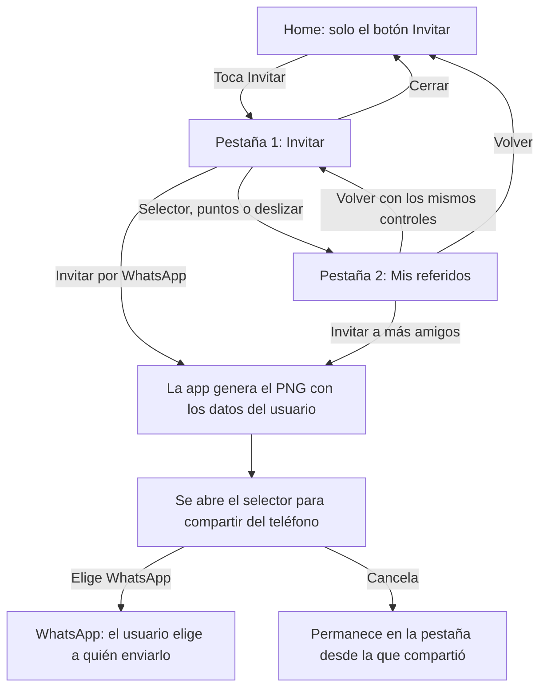
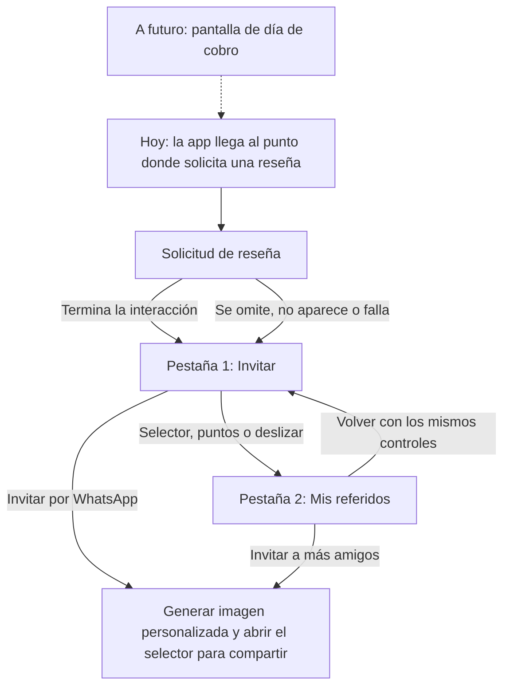

# Tu Turno · Referidos para integrar paso a paso

Este repositorio es una muestra pequeña que puedes abrir, probar y usar como
referencia para agregar el flujo de referidos a Tu Turno. Incluye las pantallas,
los textos, las animaciones, Tutu y las medallas oficiales.

**Tu tarea es llevar este flujo a la app actual, conservando su diseño y conectando
los datos reales del usuario.** Puedes apoyarte en Claude o Codex: más abajo tienes
un texto listo para copiar y pegar.

## Primero: entiende qué debe pasar

Hay **dos entradas al mismo flujo**:

1. La persona toca **Invitar** desde Home.
2. La app solicita una **reseña** y después abre **Invitar**.

En ambos casos, **Invitar es la primera pestaña** y **Mis referidos es la segunda**.
La imagen **«Mira cómo voy» se genera para compartir por WhatsApp**. No es otra
pantalla por la que el usuario deba pasar.

## Mapita 1: entrada desde Home



**Qué debes observar al probarlo:**

- Desde Home se abre **Invitar** directamente, sin pedir una reseña.
- Puedes cambiar de pestaña tocando los chips, los puntos o deslizando.
- **Mis referidos** muestra quién pagó, quién está **Pendiente** y el total ganado.
- Los botones verdes de ambas pestañas comparten la misma tarjeta y el enlace.
- **Copiar link** solo copia el enlace; no abre WhatsApp ni genera la imagen.
- Generar el PNG es un paso interno: no aparece una pantalla extra.

## Mapita 2: entrada desde la reseña



**La app actual no tiene pantalla de día de cobro.** Por ahora conecta este flujo
desde donde se pide la reseña. El cuadro punteado del mapa es una conexión futura,
no una pantalla que debas crear en esta entrega.

La reseña nunca debe ser un requisito para acceder a la invitación. No importa
cuántas estrellas elija la persona ni si la tienda decide no mostrar el diálogo.

En este mini repo, **Simulación de reseña** sirve para probar el recorrido sin
publicar una calificación. En la app real se usa la solicitud nativa de la tienda.
En iOS, la tienda no informa cuándo se cerró el diálogo ni si se publicó una
reseña; no se debe inventar esa confirmación. Los detalles están al final.

## Cómo abrir la muestra en tu computadora

Necesitas **Git**, **Node.js 22.13 o posterior** y **Expo Go para SDK 57**.
Si te falta alguno, pide ayuda para instalarlo antes de continuar.

1. Abre una terminal en la carpeta donde guardas tus proyectos.
2. Descarga este repositorio y entra en su carpeta:

   ```sh
   git clone https://github.com/oscarmiranda90/tuturno-referidos-mini.git
   cd tuturno-referidos-mini
   ```

3. Instala lo que necesita y revisa que esté bien:

   ```sh
   npm ci
   npm run check
   ```

   `npm ci` instala las dependencias. `npm run check` revisa el código y ejecuta
   las pruebas. Si aparece un error, conserva el mensaje completo y pídele a tu
   agente que lo revise antes de seguir.

4. Abre la muestra:

   ```sh
   npm start
   ```

   Verás un QR. Escanéalo con Expo Go desde un teléfono en la misma red.
   También puedes pulsar `a` si tienes un emulador Android encendido o `i` para
   un simulador iOS en una Mac con Xcode.

5. Para probar la otra entrada, detén Metro con `Ctrl+C` y ejecuta:

   ```sh
   npm run start:review
   ```

   Abre o recarga el proyecto en Expo Go. Prueba **Omitir reseña** y luego, en
   otra prueba, elige estrellas y toca **Simular envío de reseña**. En ambos casos
   debes llegar a **Invitar**.

Si Expo Go dice que el proyecto es incompatible, descarga la versión para
**SDK 57** desde [la página de Expo](https://expo.dev/go?sdkVersion=57).
La generación de la imagen y WhatsApp se prueban en Android o iOS.

## Básicamente: pégame en tu agente, Claude o Codex, y pídele esto

Abre **el proyecto de la app actual de Tu Turno** en tu editor y usa su agente.
Copia el bloque completo de abajo. El agente debe tener acceso tanto a la app
actual como a este repositorio de referencia. Si no lo tiene, comparte la carpeta
o el enlace; no necesita contraseñas ni datos de usuarios para estudiar la muestra.

```text
Necesito integrar el flujo de referidos en la app actual de Tu Turno.

Referencia pública:
https://github.com/oscarmiranda90/tuturno-referidos-mini

Primero lee su README y revisa su código. Revisa también la estructura y las
instrucciones del proyecto actual. Si no tienes acceso a alguno de los dos
proyectos, indícame exactamente qué carpeta necesitas.

Usa la muestra como referencia de pantallas, textos, márgenes, animaciones,
Tutu y medallas. Integra el flujo dentro de la app existente, respetando sus
herramientas y navegación. No reemplaces la app completa por la muestra ni
actualices su framework solo porque la muestra usa Expo SDK 57.

Implementa estas dos entradas:
1. Desde el botón Invitar del Home real: abrir directamente Invitar.
   No pedir una reseña en esta entrada. El Home vacío del mini repo solo sirve
   para demostrar el botón; conserva el Home de la app real.
2. Desde donde la app pide una reseña: usar la solicitud nativa existente y
   después continuar a Invitar. Si no aparece, se omite o falla, continuar igual.
   No exigir estrellas positivas ni afirmar que se publicó una reseña.

La app actual NO tiene pantalla de día de cobro. No la crees ni la uses como
requisito. A futuro esa pantalla podrá activar la misma secuencia de reseña.
La pantalla Simulación de reseña es solo para pruebas: no la uses como reseña
real en producción. Conserva los límites de frecuencia de la app actual.

Dentro del flujo:
- Primera pestaña: Invitar. Segunda pestaña: Mis referidos.
- Mantén sincronizados el selector doble, los puntos y el deslizamiento.
- Conserva el confeti animado, Tutu y las medallas oficiales.
- Mantén los textos aprobados y el estado Pendiente del listado.

Mira cómo voy NO es una pantalla. Al compartir, genera una imagen estática
1080x1920 con el nombre completo, los SAN cobrados confirmados y el nivel real
del usuario, junto con su enlace de referido. El contador no es la cantidad
de amigos ni de cuotas pagadas. No dejes el nombre Pedro ni la medalla Diamante
fijos: son datos de ejemplo. El usuario elige WhatsApp y los destinatarios.
En Android, revisa la limitación documentada de compartir imagen y descripción:
la muestra copia el texto/enlace para pegarlo manualmente; no prometas envío
conjunto automático sin implementar y verificar el transporte necesario.

Conecta la sesión y los servicios que ya existen. No inventes endpoints ni
confirmaciones de pagos. Si falta un dato o un servicio, separa claramente
la integración pendiente y explícame qué debe entregar el backend.

Prueba las dos entradas, las dos pestañas y la imagen personalizada. Ejecuta
los chequeos del proyecto. Al terminar, explícame en español:
- Qué archivos cambiaste y para qué.
- Cómo probar cada entrada paso a paso.
- Qué funciona y qué sigue pendiente de datos o pruebas en un teléfono real.
```

**Revisa el resultado con el agente.** Si dice que terminó, pídele que te muestre
ambos recorridos y la imagen generada con un perfil distinto al de la muestra.

## Cómo saber si la tarea está lista

- [ ] Desde el Home real, **Invitar** abre la primera pestaña sin pedir reseña.
- [ ] Desde la reseña, el flujo continúa a **Invitar** incluso si no se califica.
- [ ] **Mis referidos** queda segunda y las tres formas de cambiar funcionan.
- [ ] Tutu, las medallas, los textos y el estado **Pendiente** se conservan.
- [ ] La imagen usa los datos del usuario y no aparece como otra pantalla.
- [ ] Se probó compartir con WhatsApp en un teléfono y copiar el enlace.
- [ ] Los chequeos pasan y queda escrito qué datos o servicios faltan conectar.

## Palabras que encontrarás

| Palabra | Qué significa aquí |
| --- | --- |
| Repositorio o repo | La carpeta de código con su historial de cambios. |
| Terminal | La ventana donde escribes comandos como `npm start`. |
| Dependencias | Las librerías que el proyecto necesita; se instalan con `npm ci`. |
| Metro | El servidor local que inicia Expo para cargar la app mientras desarrollas. |
| Backend | El servidor que entrega los datos y confirma las operaciones reales. |
| Datos de muestra | Información ficticia para ver las pantallas; no son datos de producción. |
| Reseña nativa | El diálogo de calificación que controla Android o iOS. |
| PNG | El archivo de imagen que se genera al compartir. |

## Referencia técnica para integrar

Puedes empezar con los pasos y mapas de arriba. Abre esta sección cuando necesites
los comandos adicionales, las limitaciones por plataforma o los archivos concretos.

<details>
<summary>Ver detalles técnicos, datos de ejemplo y organización del código</summary>

## Instalación y ejecución

Requisitos: Node.js **22.13 o posterior**, npm y **Expo Go compatible con SDK 57**.
La versión más reciente de Expo Go en la tienda puede corresponder a otro SDK.
Descarga el cliente compatible desde [Expo Go](https://expo.dev/go?sdkVersion=57).

```sh
npm ci
npm run check
npm start
```

Escanea el QR desde un teléfono conectado a la misma red. También puedes pulsar
`a` para abrir un emulador Android encendido o `i` para un simulador iOS en macOS
con Xcode.

```sh
npm run android
npm run ios
```

Estos comandos usan Expo Go y no requieren generar proyectos nativos. Para
trabajar junto a la app completa usando otro puerto de Metro:

```sh
npm start -- --port 8083
```

Todas las pantallas de demostración usan modo claro. Se incluyen la tipografía
Outfit, las animaciones de Tutu con fondo transparente, su imagen estática, las
medallas oficiales del Club y los recursos de marca.

La generación y el envío del PNG se deben probar en Android o iOS. En la versión
web, el botón comparte el texto y el enlace.

## Las dos maneras de entrar al flujo

| Entrada | Recorrido actual | Regreso |
| --- | --- | --- |
| Desde Home | Home vacío → botón **Invitar** → **Invitar** / **Mis referidos** | Cerrar o volver regresa a Home |
| Desde una solicitud de reseña de la app | Interacción de reseña → **Invitar** / **Mis referidos** | Cerrar o volver regresa a Home |

**Invitar siempre es la primera pestaña; Mis referidos es la segunda.** El selector
doble superior, los indicadores sobre el botón de WhatsApp y el deslizamiento
horizontal controlan las mismas páginas.

La entrada desde Home abre directamente **Invitar**, sin pedir una reseña, incluso
si el usuario ya tiene referidos.

### 1. Entrada desde Home

Al iniciar normalmente aparece un Home vacío con un único botón **Invitar**. Es una
pantalla mínima para demostrar la integración. Al tocar el botón se abren las
pantallas aprobadas de invitación y referidos.

### 2. Entrada desde la solicitud de reseña

**La versión actual de Tu Turno no tiene una pantalla de día de cobro.** Por eso,
esta entrada comienza **desde donde se solicita la reseña**, sin pasar por una
celebración de cobro, un comprobante, una transferencia o una confirmación de pago.

Para probar una reseña simulada de forma reproducible:

```sh
npm run start:review
# Opcional: usar un puerto separado.
npm run start:review -- --port 8083
```

También puedes abrir el proyecto que ya está ejecutándose mediante esta URL de
prueba:

```text
exp://<metro-host>:8083/--/?entry=review
```

Sustituye `<metro-host>` por la dirección de Metro que aparece en tu terminal.

La pantalla **Simulación de reseña** permite elegir estrellas y tocar **Simular
envío de reseña**, o tocar **Omitir reseña**. Ambas opciones continúan a **Invitar**,
independientemente de la calificación elegida. La simulación no publica ninguna
calificación en una tienda. Home conserva únicamente su botón de invitar.

Para intentar la solicitud nativa de la tienda:

```text
exp://<metro-host>:8083/--/?entry=review&mode=native
```

La simulación también ofrece **Intentar reseña nativa**. `expo-store-review` verifica
la disponibilidad antes de solicitarla. La tienda puede no mostrar el diálogo por
sus límites, el entorno de ejecución o el historial del usuario. Si la solicitud
no está disponible o falla, el flujo continúa a la invitación. No se exige enviar
una reseña ni dar una calificación positiva.

Ninguna plataforma informa si se envió una calificación. Android puede indicar que
terminó el flujo nativo; en iOS, StoreKit solo confirma que se hizo la solicitud.
Por ello, iOS no permite garantizar que la invitación espere hasta que se cierre
un diálogo de reseña visible.

A futuro, cuando Tu Turno incorpore la pantalla de día de cobro, esa pantalla podrá
activar esta misma entrada:

```text
Futuro: día de cobro → solicitud de reseña → Invitar → Mis referidos
Actual:               solicitud de reseña → Invitar → Mis referidos
```

La integración actual comienza en la solicitud de reseña y no requiere simular un
cobro previo.

### Accesos para el emulador Android

Con Metro en el puerto 8083 y un emulador encendido:

```sh
adb reverse tcp:8083 tcp:8083
adb shell 'am start -a android.intent.action.VIEW -d "exp://127.0.0.1:8083/--/?entry=home" host.exp.exponent'
adb shell 'am start -a android.intent.action.VIEW -d "exp://127.0.0.1:8083/--/?entry=review" host.exp.exponent'
adb shell 'am start -a android.intent.action.VIEW -d "exp://127.0.0.1:8083/--/?entry=review&mode=native" host.exp.exponent'
```

Para capturas directas también existen `?entry=invite` y `?entry=referrals`.
En una compilación de desarrollo, el esquema registrado acepta
`tuturnoreferidos://review`, `tuturnoreferidos://review?mode=native`,
`tuturnoreferidos://invite` y `tuturnoreferidos://home`.
En Expo Go se usan las URL `exp://` del proyecto.

## La imagen «Mira cómo voy»

La tarjeta es una imagen adjunta para compartir. **No tiene ruta, vista ampliada,
modal ni animación dentro de la app.** El teléfono pequeño del segundo paso es una
ilustración explicativa.

Al compartir, la app convierte la plantilla estática de proporción 9:16 en un
**PNG de 1080 × 1920** y lo entrega al selector nativo junto con el mensaje de
invitación y el enlace de referido. El usuario elige WhatsApp y los destinatarios.
Cada acción genera la imagen con el perfil actual; no reutiliza la tarjeta de
otra persona.

La tarjeta muestra el nombre completo, la cantidad de **SAN cobrados confirmados**
y el nivel del Club guardado en el perfil. «Ya cobré · 7 · San» cuenta cobros
recibidos: no cuenta amigos invitados, cuotas pagadas ni la racha del Club.
La medalla oficial corresponde al nivel del usuario.

Tutu usa una imagen PNG fija en la tarjeta compartida. Dentro de la pantalla de
invitación, Tutu y el confeti conservan sus animaciones y respetan la preferencia
de reducir movimiento.

- **iOS:** `Share.share` recibe la URL del archivo PNG y el texto con el enlace.
- **Android:** `expo-sharing` comparte el PNG y copia el texto con el enlace para
  que el usuario lo pegue como descripción en WhatsApp. Esta implementación no
  adjunta automáticamente la descripción junto con la imagen. Si producción
  necesita un envío combinado de imagen y descripción, se debe implementar ese
  transporte nativo en una compilación de desarrollo.
- **Copiar link:** copia únicamente la URL de referido, sin generar ni enviar un PNG.

Abrir el selector para compartir no confirma la entrega. Hay que verificar la
imagen, el texto y el enlace con WhatsApp instalado en un teléfono físico.
El enlace es una URL ilustrativa de Tu Turno; este proyecto no incluye su página
de destino, el procesamiento de atribución ni el registro del invitado.

## Datos de ejemplo e integración con Tu Turno

La muestra reproducible utiliza **Pedro Pérez**, **7** SAN cobrados, nivel
**Diamante**, siete referidos, cinco primeras cuotas pagadas, dos filas
**Pendiente** y un total ganado de **15$**. Las identidades y los datos de pago son
ficticios. El proyecto no realiza pagos bancarios ni operaciones financieras.

Para integrar estas pantallas:

1. Entrega el perfil de la sesión a `ReferralsScreen` mediante la propiedad `user`:
   `firstName`, `lastName`, `collectedSanes`, `club.points.tier` y los campos de
   identidad. `invitationProfile` hace que los datos de la sesión reemplacen los
   valores de ejemplo.
2. Sustituye los datos ficticios de `ReferralProvider` y `demo/data.json` por la
   fuente autenticada de la app. Reemplaza también la búsqueda del usuario de
   demostración dentro del proveedor y la interfaz. Los datos de muestra no deben
   usarse como respaldo en producción.
3. Obtén del backend existente el código de referido, la configuración del país,
   los premios, la elegibilidad y el resumen de primeras cuotas pagadas.
   `ReferralsService.getSummary` documenta el contrato opcional de lectura del
   listado. El backend conserva la responsabilidad de la atribución, los controles
   de fraude, la confirmación de pagos y el envío de premios.
4. Ejecuta `reviewThenInvite(requestNativeReview, openInvitation)` desde el punto
   donde la app actual solicita la reseña. Desde Home se llama directamente a
   `openInvitation`. Conserva la política de frecuencia y prevención de duplicados
   de Tu Turno; esta demostración permite repetir las pruebas manualmente.
5. Conserva los textos y las ilustraciones aprobados. Conecta los datos sin añadir
   estados visibles de premios. El listado distingue entre quienes pagaron y
   quienes están **Pendiente**; el total suma los premios ganados por la primera
   cuota, independientemente de su posterior envío bancario.

Este proyecto no incorpora la cuenta Expo, el identificador EAS, la URL de
actualizaciones ni el remoto Git de la app original. Sus identificadores nativos
y esquema de URL son propios de esta demostración. No necesita secretos de
entorno. La publicación de una versión de producción queda fuera de su alcance.

## Organización del código

```text
App.tsx                              Proveedores y modo claro
src/app/MiniApp.tsx                  Coordinación de entradas desde Home y reseña
src/app/entry.ts                     Lectura de las URL de prueba
src/features/home/screens/           Home vacío con el botón Invitar
src/features/referrals/screens/      Páginas aprobadas y simulación de reseña
src/features/referrals/components/   Invitación, listado, tarjeta, animaciones y controles
src/features/referrals/domain/       Lecturas, perfil y secuencia de reseña
src/features/referrals/demo/         Datos ficticios de referencia
src/features/referrals/services/     Reseña nativa y contrato de lectura del listado
src/features/referrals/state/        Proveedor de datos de demostración
src/features/club/components/        Componente de medallas oficiales
src/shared/                         Perfil mínimo, tipografía, tema, montos, Tutu y UI
assets/                             Recursos de marca, Tutu y medallas utilizados
```

No se incluyen login, registro, Home completo de producción, pantalla del Club,
flujo de pagos, pantalla de día de cobro, administración, backend ni el historial
Git de la app completa.

## Verificación y pruebas de integración

```sh
npm run format
npm run check
```

`check` ejecuta TypeScript, la revisión de imports y recursos, la detección de
ciclos, el formato, la validación de español neutro y las pruebas del flujo de
reseña, las rutas de entrada, los datos del listado y el perfil de la tarjeta.

Antes de integrar en Tu Turno, verifica ambas entradas en Android e iOS, el
selector, los indicadores, el deslizamiento, la reducción de movimiento, los
cuatro niveles de medallas, nombres largos, el contenido del PNG, el portapapeles,
la reseña nativa no disponible y la entrega real mediante WhatsApp.

Una reseña simulada no equivale a una calificación publicada en la tienda, y una
imagen compartida no confirma un referido ni un pago.


</details>
